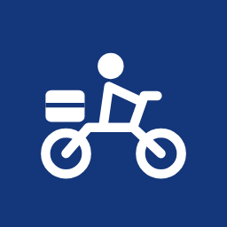

# Sawaari



A fake delivery-rider app built as a prop for a short film. One phone (the rider, on camera) receives a delivery-style notification. The message, timing and look are controlled by the crew.

It is a small, real Android app: React Native + Expo, push notifications through Expo's push service and Firebase Cloud Messaging, and a GitHub Actions pipeline that builds the APK on every push.

## How it works

The same app runs in one of two modes, picked on first launch:

| Mode | Who holds it | What it does |
|---|---|---|
| **Rider** | The actor | A clean, branded rider home screen for the camera. Long-press the logo to open a hidden **crew panel**. |
| **Director** | The crew | Writes the title and message, then sends it to the rider phone instantly or after a countdown. |

There are two ways to fire a notification:

- **Remote cue (director → rider):** sent through Expo's free push service. Needs internet on both phones.
- **Offline timer (rider phone only):** scheduled from the crew panel. It fires after N seconds with no network, so it works as the backup on location.

Both phones keep an editable library of messages (pre-loaded with the script's notifications) and an editable rider dashboard. The director can send dashboard changes to the rider phone. Android can't colour a remote push, so when the rider app is open the app hides the incoming push and re-shows it locally in the chosen colour.

## Rebranding

Everything about the app's identity is in [`brand.config.json`](brand.config.json):

```json
{
  "appName": "Sawaari Rider",
  "companyName": "Sawaari",
  "tagline": "Har sawaari, sahi jagah.",
  "primaryColor": "#14367A",
  "lightColor": "#BFDDFF",
  "notificationColor": "#14367A",
  "riderName": "Vikram"
}
```

To change the icon, replace the PNGs in `assets/`. They're generated from the SVG sources in `assets/brand/`.

Edit the file, commit, and a new APK appears under **Releases** about 15 minutes later.

## Project structure

```
App.tsx              mode picker + routing
src/RiderHome.tsx    on-camera screen + hidden crew panel
src/RiderDashboard.tsx  struggling-rider dashboard (earnings, dues, orders)
src/defaults.ts      the template: script messages + dashboard numbers
src/Director.tsx     tabs: Send / Messages / Dashboard
src/editors/         message, dashboard and order editors
src/useStored.ts     saves edits on the phone
src/notify.ts        channels, permissions, local schedule, remote send (timeout + retry)
src/validate.ts      input checks: rider code, hex colour, lengths, delay
src/ErrorBoundary.tsx  crash screen with reset instead of app close
brand.config.json    name, colours, rider name
.github/workflows/   APK build on GitHub Actions
```

## Building

There's nothing to install locally. GitHub Actions runs `expo prebuild` and Gradle and publishes `Sawaari-Rider-<n>.apk` as a release. To develop locally: `npm install`, then `npx expo run:android` with a phone connected.

Remote push needs an Expo project ID in `brand.config.json` (`easProjectId`), plus the Firebase FCM V1 service-account key uploaded to that project's credentials on expo.dev.
